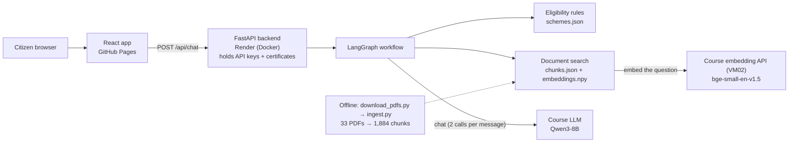
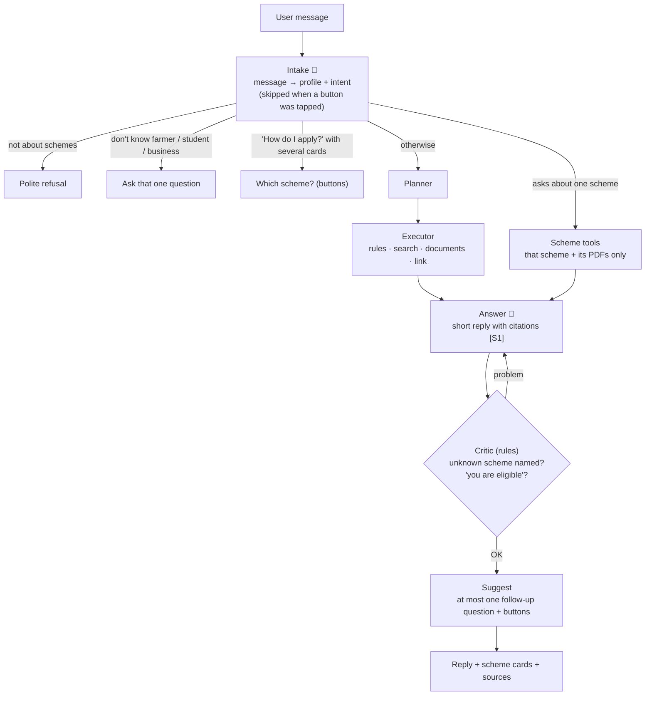

# JanSahayak

A chatbot that helps Indian citizens (farmers, students, entrepreneurs) find government schemes, check the stated eligibility rules, and see the documents and official links they need. Works in English and Hindi, typed or spoken. IIT KGP Capstone, Track B.

📖 **Docs**
- [How it works (simplified)](docs/HOW_IT_WORKS_SIMPLIFIED.md): every piece in one page of diagrams, start here
- [How JanSahayak works](docs/HOW_IT_WORKS.md): the full backend in plain English (chat flow, eligibility rules, follow-up questions)
- [Document search (RAG) and embeddings](docs/RAG_AND_EMBEDDINGS.md): how PDFs become searchable, how good search is, how to add a PDF
- [Evaluation and tracing](docs/EVALUATION.md): the 79-query test set, metrics, failure types, request traces, prompting baseline · [latest results](eval/results/latest.md)

## Architecture



- **No database.** Scheme rules and the search index are files inside the backend container. Chat sessions live in server memory and are cleared on reset or restart.
- **Eligibility is decided by rules, never by the AI.** The AI only reads the profile and writes the reply from the rule results and cited PDF passages.

### One chat message



🧠 = calls the AI. Only Intake and Answer do, because the course key allows one AI request at a time.

## Run locally

```bash
# backend (Python 3.11+)
cd backend
python -m venv .venv && .venv/Scripts/pip install -r requirements.txt   # mac/linux: .venv/bin/pip
cp ../.env.example .env                       # fill in keys and certificate paths (empty = MOCK mode)
.venv/Scripts/python ../scripts/test_llm.py   # check the AI connection
.venv/Scripts/uvicorn app.main:app --reload   # http://localhost:8000/health

# frontend (Node 20+)
cd frontend && npm install && npm run dev     # http://localhost:5173
```

The search index (`chunks.json`, `embeddings.npy`) is already in git. To rebuild it, see [Adding a new PDF](docs/RAG_AND_EMBEDDINGS.md#9-adding-a-new-pdf).

## Deploy

**Backend → Render:** New → Blueprint → pick this repo (it reads `render.yaml`). Then:
- Env vars: `MODEL_BASE_URL`, `MODEL_API_KEY`, `EMBED_API_KEY`, `FRONTEND_ORIGIN=https://<user>.github.io`
- Secret Files: the LLM certificate as `ca.crt`, the embedding certificate (`vm02-ca.crt`) as `embed-ca.crt`
- Open `/health` to check.

**Frontend → GitHub Pages:** Settings → Pages → Source: *GitHub Actions*. Settings → Variables → `VITE_API_URL=https://<your-app>.onrender.com`. Every push to `main` redeploys.

## Data

| File | What it holds |
|---|---|
| `backend/data/schemes.json` | 28 schemes: eligibility rules, benefits, documents, official links, short names |
| `backend/data/sources.json` | All 87 PDFs we collected, each tagged (`use`, `later`, `need_ocr`…) |
| `backend/data/chunks.json` + `embeddings.npy` | The search index built from the 33 `use` PDFs |

Scheme data is a draft (`needs_review`) until someone checks each scheme against the official guideline.

## Tests

```bash
cd backend
.venv/Scripts/python tests/test_followups.py   # follow-up questions: every conversation ends, nothing asked twice
.venv/Scripts/python ../eval/retrieval_eval.py # document search: right scheme found? (15/15 today)
.venv/Scripts/python ../eval/run_eval.py       # whole chat on 79 queries with gold answers (~10 min, real AI)
.venv/Scripts/python ../eval/prompt_baseline.py # one prompt, no agents, 4 prompting strategies (~45 min, real AI)
```

Every reply includes a `trace` (steps, timings, AI calls, tokens, tools, errors; no message text). The last 200 are at `GET /api/traces`. Optional LangSmith dashboard: see [Evaluation and tracing](docs/EVALUATION.md#4-tracing-seeing-inside-each-request).

## Responsible AI

We say "may be eligible", never "you are eligible". We never ask for Aadhaar, bank or phone numbers, and profiles are not stored after the session. Every answer shows its sources, a data-as-of date and an official link, and points to a CSC for help.
