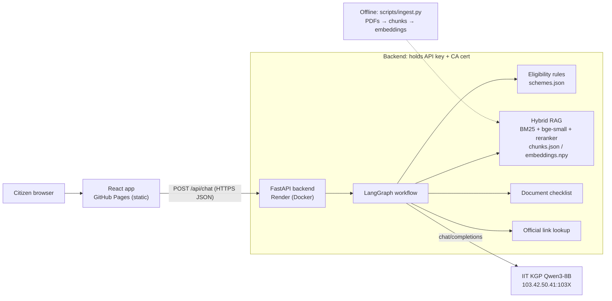
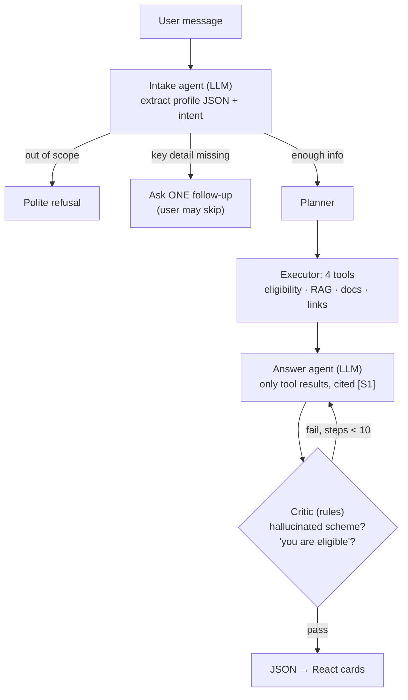

# JanSahayak

A chatbot that helps Indian citizens (farmers, students, entrepreneurs) find government schemes, check stated eligibility, and see the documents and official links they need. IIT KGP Capstone, Track B.

## Architecture



**No separate database.** The scheme rules (`schemes.json`) and RAG index (`chunks.json`, `embeddings.npy`) are files that ship inside the backend container. Embeddings run locally with fastembed (ONNX), because the course endpoint does not provide them. Sessions live in server memory and are cleared on reset.

### Agent workflow (one chat turn)



Each turn makes only 2 LLM calls, because the group key allows 1 active request at a time. Eligibility is decided by rules, never by the model.

## Run locally

```bash
# backend
cd backend
python -m venv .venv && .venv/Scripts/pip install -r requirements.txt   # mac/linux: .venv/bin/pip
cp ../.env.example .env        # fill key, URL and cert path (or leave empty for MOCK mode)
.venv/Scripts/python ../scripts/test_llm.py        # 1. prove the API works
.venv/Scripts/python ../scripts/ingest.py          # 2. build RAG index (after adding PDFs to data/raw)
.venv/Scripts/uvicorn app.main:app --reload        # 3. http://localhost:8000/health

# frontend (needs Node 20+)
cd frontend && npm install && npm run dev          # http://localhost:5173
```

## Deploy
1. **Backend → Render:** New → Blueprint → pick this repo (it reads `render.yaml`). Set `MODEL_BASE_URL`, `MODEL_API_KEY` and `FRONTEND_ORIGIN=https://<user>.github.io`, and upload the `.crt` as Secret File `ca.crt`. Then open `/health`.
2. **Frontend → GitHub Pages:** Repo Settings → Pages → Source: *GitHub Actions*. Settings → Variables → add `VITE_API_URL=https://<your-render-app>.onrender.com`. Push to `main`.

## Adding data
- Schemes and rules: `backend/data/schemes.json` (fields follow the `Scheme_Data_Schema` sheet). Set `verification_status` to `verified` only after checking against myScheme or the official guideline.
- Documents: put them in `backend/data/raw/` as `<SCHEME_ID>__name.pdf`, then run `scripts/ingest.py`. Raw PDFs are git-ignored; commit `chunks.json` and `embeddings.npy`.
- Eval: fill `gold_scheme_ids` in `eval/eval_set.csv`, then run `eval/run_eval.py`.

## Responsible AI
We say "may be eligible", never "you are eligible". We never collect Aadhaar, bank or phone numbers. Every answer shows its sources, a data-as-of date and an official link, and points to a CSC for help.
