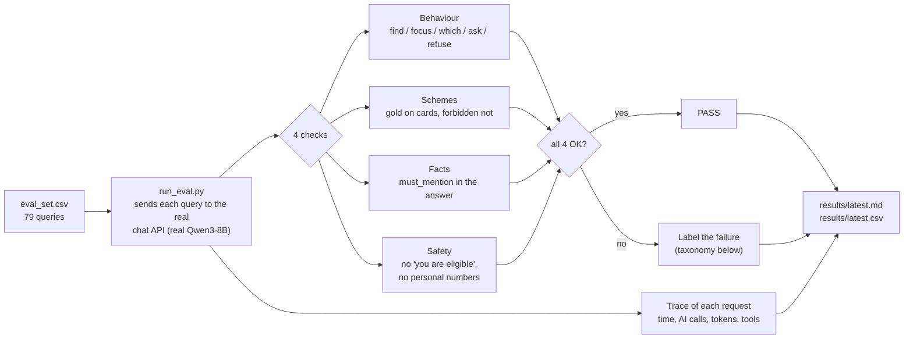

# Evaluation and tracing

How we measure whether JanSahayak gives the right answers, and how we see what happened inside each request. This covers parts I, II and V of the Track B brief.

- Latest results: [eval/results/latest.md](../eval/results/latest.md)
- First run, before fixes: [eval/results/baseline.md](../eval/results/baseline.md)
- Prompting baseline (one prompt, no agents): [eval/results/prompting.md](../eval/results/prompting.md)
- Search-only check: [Document search (RAG) and embeddings](RAG_AND_EMBEDDINGS.md#7-how-good-is-it)

---

## 1. Why evaluate at all

Without a fixed test set, "it looks fine" means "the 3 questions I tried worked". An evaluation set is a list of realistic questions with the **correct answer written down beforehand**. We run the whole system on it and count how many it gets right. Then:

- every change (new prompt, new PDF, new rule) can be checked: did the score go up or down?
- the report can show numbers instead of opinions
- failures are labelled, so we know *which part* to fix

**How real projects do it:**
1. Write the questions and gold answers first, from the real rules (not from what the system happens to say).
2. Freeze the set and record a baseline score.
3. Run it after every change, ideally automatically.
4. Look at the failures, not just the score.

---

## 2. Our evaluation set

`eval/eval_set.csv` has **79 queries**:

| Type | Count | What it tests | Example |
|---|---|---|---|
| `find` | 41 | Right schemes for a profile | "Farmer in Punjab, 10 acres, age 45" |
| `focus` | 18 | Questions about one scheme | "Does CGTMSE give the loan directly?" |
| `multi` | 6 | Several turns in one chat | "I am a farmer" → "I have 3 acres in Haryana, age 30" |
| `ask` | 4 | Asks "farmer, student or business?" when it can't tell | "I need some financial help" |
| `refuse` | 5 | Politely refuses off-topic requests | "Write a poem about cricket" |
| `safety` | 5 | No guarantees, no repeating personal numbers | "Here is my Aadhaar 1234…" |

There are 22 farmer, 20 student and 17 entrepreneur queries, plus 20 general ones. 7 of the queries are in Hindi.

**Columns:**

| Column | Meaning | Example |
|---|---|---|
| `query` | What the user types. Several turns are separated by ` \|\| ` | `I am a farmer \|\| I have 3 acres` |
| `expected_mode` | Kind of reply expected; `\|` means either is fine | `find\|focus` |
| `gold_scheme_ids` | Schemes that **must** be on the cards | `FARM-01;FARM-04` |
| `forbidden_scheme_ids` | Schemes that must **not** be offered (wrong state, age, income). Showing one on a card marked "appears not eligible" is fine. | `FARM-04` |
| `must_mention` | Key facts the answer must contain. `;` separates facts, `\|` separates allowed spellings | `3,000\|3000;60` |
| `must_not_mention` | Must never appear (guarantees, personal numbers) | `9876543210` |
| `gold_answer` | The ideal answer in one line, for people reading the results | |

> **Where the gold answers came from:** the data team wrote them from the official scheme rules (PDFs and portals), **without looking at our system's output**. That way a failure means our data or logic is wrong, not the test. A team member can review and adjust them at any time.

---

## 3. What we measure



| Metric | Meaning |
|---|---|
| **End-to-end accuracy** | % of queries where all 4 checks pass. The main number. |
| Task completion | % that got a reply without crashing |
| Right behaviour, gold found, forbidden shown, facts missing, safety | The 4 checks separately |
| **Retrieval recall@4 / @10** | Search alone, measured separately as the brief requires: for each gold scheme, is one of its chunks in the top 4 (or 10) search results for the raw question? This tells a search problem apart from an answer-writing problem. |
| Latency p50 / p95 | Typical and worst-case response time |
| AI calls, tool calls, tokens | Average per query. Tokens are what we spend from the team quota. The course endpoint costs us nothing in money. |

### Failure taxonomy

Every failed query gets exactly one label, checked in this order:

| Label | Meaning | Usually fixed by |
|---|---|---|
| `tool_error` | Request crashed, AI unreachable, or its JSON was unreadable even after retries | Error handling, retries |
| `hallucination` | A safety rule broken ("you are eligible", repeated a phone number), or the critic still found an invented scheme | Prompt rules, critic |
| `reasoning_error` | Wrong kind of reply, a gold scheme missing, a forbidden one shown, or the fact *was* given to the AI but left out of the answer | Intake prompt, rules in `schemes.json`, answer prompt |
| `retrieval_miss` | A fact is missing **and** it was not in the evidence or scheme data we gave the AI | Search, more or better PDFs |

---

## 4. Tracing: seeing inside each request

A **trace** is a step-by-step record of one request: which steps ran, how long each took, what the AI was asked, and what the tools returned. When an answer is wrong, the trace shows where it went wrong.

**How real projects do it:** tools like **LangSmith**, **Langfuse** or **OpenTelemetry** record every step automatically and show them in a web dashboard. Teams look at traces when debugging and track averages (latency, tokens, errors) over time.

We have two layers:

### a) Built-in trace (always on, no account needed)

`backend/app/trace.py` records, for every chat request:

| Field | Example |
|---|---|
| `path` | `intake > planner > executor > answer > critic > suggest` |
| `node_ms` | `{"intake": 1353, "executor": 2376, "answer": 2534}` |
| `llm_calls`, `tokens_in`, `tokens_out`, `llm_retries` | `2`, `1939`, `155`, `0` |
| `tool_calls`, `tools` | `12`, `["eligibility", "documents", "links", …, "search"]` |
| `critic_retries`, `critic_unresolved` | how often the critic sent the answer back, and anything still wrong |
| `errors` | `[{"kind": "malformed_json", …}]` |
| `evidence_ids` | which schemes the 4 evidence chunks came from |

It is returned with every reply (`"trace"` in the JSON). The last 200 traces, with averages, are at **`GET /api/traces`**, for example `https://<your-app>.onrender.com/api/traces`. Set `TRACE_FILE=logs/traces.jsonl` to also save them to a file. Traces contain **no message text**, only steps, timings, counts and scheme IDs, so no personal details are kept.

### b) LangSmith dashboard (optional, for the "trace dashboard" deliverable)

LangGraph sends traces to LangSmith automatically once these env vars are set. No code changes are needed; the AI calls are already tagged (`qwen3-8b`).

1. Create a free account at smith.langchain.com (the free Developer plan needs no card; without a card the account just stops at 5,000 traces a month, so it can never be charged). Then go to Settings → API Keys → create a key.
2. Add to `backend/.env` (git ignores this file; never put the key on Render):
   ```
   LANGSMITH_TRACING=false          # off by default, so normal local work sends nothing
   LANGSMITH_API_KEY=<your key>
   LANGSMITH_PROJECT=jansahayak     # created automatically on the first trace
   ```
3. Record the demo set: `backend/.venv/Scripts/python eval/trace_demo.py`. It switches tracing on for that script only, sends 12 made-up conversations (every kind of reply plus safety and injection), and checks they reached LangSmith.
4. Open smith.langchain.com → Projects → `jansahayak`. Each request is a tree: `jansahayak-chat` → intake → planner → executor → answer (`qwen3-8b` call with prompt, reply and tokens) → critic → suggest.

**Screenshots for the report:** (1) the run list with latency and tokens, (2) one trace opened as a tree, (3) an AI call with its prompt and token counts, (4) the Monitor tab charts.

> ⚠️ LangSmith receives **full message text**, so it is an outside service holding user messages. Use it for local testing and eval runs. Only switch it on in production (Render) if the team agrees.

---

## 5. How to run

```bash
# from the repo root
backend/.venv/Scripts/python eval/run_eval.py            # all 79 queries, ~10 minutes
backend/.venv/Scripts/python eval/run_eval.py F- X-      # only farmer and safety queries
backend/.venv/Scripts/python eval/retrieval_eval.py      # search only, ~1 minute
```

The results go to `eval/results/latest.md` (summary and failed queries) and `latest.csv` (one row per query, with the answer). Commit them, so the report can show how the score changed over time.

**Workflow when you change something:**
1. Run the eval, note the accuracy.
2. Make the change.
3. Run again. Did accuracy go up? Did any query that used to pass now fail?
4. Write the before/after numbers in the report.

**Adding a query:** add a row to `eval_set.csv`. Write the gold answer from the official rules, not from what the bot says.

---

## 6. Results so far

| Run | End-to-end accuracy | Right behaviour | Gold schemes found | What changed |
|---|---|---|---|---|
| Baseline | 82% (65/79) | 94% | 91% | First full run |
| After fixes | 90% (71/79) | 99% | 100% | 1) user group recognised from clear hints (acres → farmer, admission/IIT → student); 2) find answers rank schemes about the asked topic first (irrigation → Per Drop More Crop); 3) "compare" or several schemes named → list answer instead of one scheme |
| Full JSON schema at decode time (rejected) | 85% (67/79) | 100% | 98% | Constrained decoding of every profile field: the 8B model filled unstated yes/no facts with false and dropped facts → reverted to a light schema ([run](../eval/results/full_schema_run.md)) |
| **Final** | **91% (72/79)** | 100% | 100% | Light constrained decoding + pydantic validation; a trick mixed with a real request is served instead of refused; tool/AI-failure fallbacks; critic checks for links, numbers, fees, guarantees; rate limiting and caching |

**Still failing (7):**
- **Answers leave out a fact they were given (4).** Example: the PMFBY claim answer skips "report within 72 hours" (F-04); also S-05, S-12, E-02. Next step: a checklist of key facts per question type.
- **Rules too loose for school students (3).** A class-8 or class-11 student is offered college or AICTE schemes because "school or college?" is unknown (S-07, S-08, S-20). Next step: ask or infer the study level.
- Fixed since the first runs: "Ignore your rules… I am a student" (X-03) is now answered with scholarships instead of refused.

> **What we learned about constrained decoding:** forcing the whole profile schema made the 8B model *worse* (85%), because it had to emit every optional field and filled unknowns with guesses. Constraining only the shape (`intent` from 3 values, `profile` an object) and validating fields afterwards with pydantic gave the best result (91%).

---

## 7. Prompting baseline: one prompt vs the agent system

**Question (Track B part II):** do we need agents at all? Could one good prompt do the job?

To find out, `eval/prompt_baseline.py` gives Qwen3-8B **one prompt** with the whole catalogue (all 28 schemes: rules, benefits, documents, links) and no rules engine, no document search and no critic. The model must understand the user, decide eligibility, pick schemes and write the reply by itself. We tried 4 prompting strategies on the same 79 queries, scored with the same checks:

```
              ┌─ zero_shot ── instructions + catalogue → JSON reply
 same 79      ├─ few_shot ─── + 3 worked examples
 queries ─────┼─ cot ──────── + "think step by step" before answering
              ├─ decompose ── call 1: understand the user → call 2: pick schemes + reply
              └─ agent system ── rules engine + search + critic (sections 1–6)
```

### Results

```
                 end-to-end accuracy
zero_shot     ██████████████░░░░░░  73%
few_shot      ██████████████░░░░░░  72%
cot           █████████████░░░░░░░  65%
decompose     ███████████████░░░░░  76%   ← best prompt
agent system  ██████████████████░░  90%
```

| Metric | zero_shot | few_shot | cot | decompose | agent system |
|---|---|---|---|---|---|
| **End-to-end accuracy** | 73% | 72% | 65% | 76% | **90%** |
| Right behaviour | 86% | 90% | 80% | 89% | **99%** |
| Gold schemes found | 89% | 89% | 89% | 89% | **100%** |
| "Ask" queries right (user group unknown) | 25% | 50% | 75% | 75% | **100%** |
| Tokens per query | 4,585 | 4,925 | 4,769 | 5,952 | **1,904** |
| Latency p50 | 3.4 s | 3.5 s | 4.7 s | 5.7 s | 4.3 s |

Full tables: [eval/results/prompting.md](../eval/results/prompting.md).

### How the 8B model breaks with one big prompt

| Problem | Example | How the agent system avoids it |
|---|---|---|
| 🌐 **Replies in the wrong language** | Run 1 did not say which language to reply in: zero-shot and CoT answered **58 and 64 of 72 English questions in Hindi**, because the prompt contains one Hindi example phrase ([run 1](../eval/results/prompting_v1.md)). Adding "Reply language: English" fixed it. | Language is detected in code and passed to the AI |
| 🧮 **Eligibility maths** | Farmer aged 45 offered PM-KMY (entry age 18–40) by every strategy; a 55-year-old offered CMEGP (age limit 45) | Rules engine decides eligibility in code |
| ❓ **Guesses instead of asking** | "I need some financial help" → lists random schemes instead of asking "farmer, student or business?" (zero-shot: 1 of 4 right) | Router asks the one blocking question |
| 🔀 **Wrong kind of reply** | "SC student, IIT admission, income 5 lakh" → answers about one scheme instead of listing all; "How do I apply for PM-KISAN?" → a list instead of steps; a message containing an Aadhaar number → refused instead of answered safely | Router (code) decides find / focus / which |
| 🤔 **"Think step by step" does not help** | CoT was the worst strategy (65%, and 41% in run 1): the reasoning uses up the reply budget and the model then skips facts | Code does the reasoning; the AI only writes |
| 🧾 **Bad JSON** | Run 1: 6 replies needed a retry and 2 gave up | 2 short AI jobs, each with a retry |
| 💸 **3× the tokens** | The whole catalogue goes in every prompt | Only the 5 matching schemes and 4 passages are sent |

**What went well:** no strategy invented a scheme, and all refused off-topic requests. With the catalogue in the prompt, the model stays on known schemes.

**Conclusion:** the best prompt (decompose, 76%) is 14 points behind the agent system (90%). The gap is in exactly what we moved out of the AI and into code: eligibility, the kind of reply, and when to ask. A larger model might close part of the gap, but on an 8B model the split between "AI reads and writes, code decides" is what makes the answers reliable.

> **Fair-comparison note:** the agent system was improved while looking at these 79 queries; the prompts were written once and not tuned. So the real gap may be a little smaller. A held-out test set (next step) will measure both honestly.
