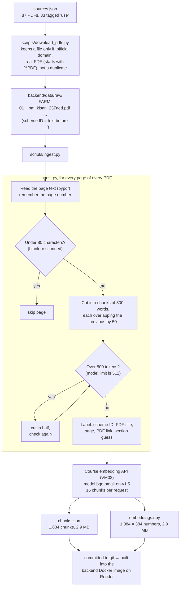
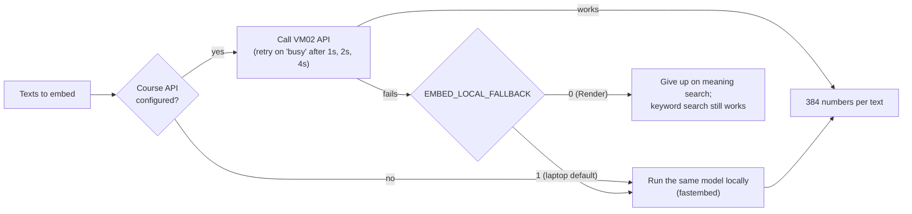
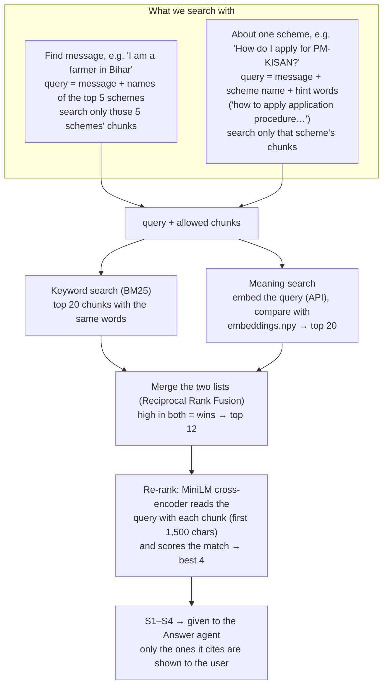

# Document search (RAG) and embeddings

How JanSahayak turns government PDFs into something it can search, how a search runs, how good it is, and how to add a new PDF.

For the rest of the app (chat flow, eligibility rules, follow-up questions), see [How JanSahayak works](HOW_IT_WORKS.md).

---

## 1. In one minute

- **RAG** means: before the AI writes an answer, we find the most relevant paragraphs in the official PDFs and give those to the AI. The answer is then based on the documents, and every claim can be cited (`[S1]`, `[S2]`…).
- An **embedding** is a list of **384 numbers** that describes what a paragraph *means*. Paragraphs with similar meaning get similar numbers, so "farm loan" can find a "Kisan Credit Card" paragraph even with no shared words.
- We prepare everything **once, on a laptop**. That produces two files that ship with the backend: `chunks.json` (the text) and `embeddings.npy` (the numbers).
- On every question we combine **keyword search** and **meaning search**, then a small **re-rank** model picks the best 4 paragraphs.
- **RAG never decides eligibility.** That is done by the rules in `schemes.json`. RAG only supplies the explanation (how to apply, documents, benefits) and the citations.

---

## 2. The data

`backend/data/sources.json` lists all **87 PDFs** we collected. Each one has a status tag:

| Tag | Count | Meaning |
|---|---|---|
| `use` | 33 | Official, English, readable text. **These are searched.** |
| `later` | 20 | Fine, but not needed yet (duplicates, extra state circulars) |
| `not_citizen` | 16 | Written for officials or banks, not citizens |
| `need_ocr` | 15 | Scanned images with no text inside, so they can't be searched without OCR |
| `not_english` | 2 | Hindi or Marathi only |
| `broken` | 1 | Link dead or file corrupt |

All **28 schemes** have at least one `use` PDF. Today the index holds **1,884 chunks**. The biggest scheme is PMFBY with 470 chunks; the smallest is PMEGP with 3 (we only have a short summary for it).

Raw PDFs (about 73 MB) are **not** in git. Anyone can re-download them with `scripts/download_pdfs.py`.

---

## 3. Building the index (offline, done once)



Why these settings:

| Setting | Value | Why |
|---|---|---|
| Chunk size | 300 words | Big enough to hold a full rule or step list, small enough to stay on one topic |
| Overlap | 50 words | A sentence cut at a chunk edge still appears whole in the next chunk |
| Token cap | 500 | The model accepts at most 512 tokens. Badly extracted text (glued words, tables) can be 300 words but 3,000 tokens, so we halve it. |
| Batch | 16 per request | Limit set by the course API |
| Min page length | 80 characters | Skips blank and scanned pages |

A full rebuild takes about 2.5 minutes.

---

## 4. The embedding model

**Model:** `bge-small-en-v1.5` (made by BAAI). It is small and fast, and the course provides it. Every chunk becomes 384 numbers, scaled to length 1 so similarity is a simple multiplication.

**Where it runs:** `backend/app/embed.py`



- The API and the local model give **identical numbers** (tested: similarity 1.0), so an index built one way can be searched the other way.
- On Render the local fallback is **off**. The free server has 512 MB of memory, and loading the model there caused out-of-memory crashes.
- Settings (in `backend/.env` locally, Render env vars in production): `EMBED_BASE_URL`, `EMBED_API_KEY`, `EMBED_MODEL`, `EMBED_CA_CERT_PATH` (the `vm02-ca.crt` file), `EMBED_LOCAL_FALLBACK`.

---

## 5. Where the vectors are stored (no vector database)

There is no separate vector database. `embeddings.npy` is loaded into memory when the backend starts, and every search compares the question with **all 1,884 rows** in one matrix multiplication. That takes a few milliseconds.

| | Our file approach | A vector database (FAISS, Chroma, pgvector) |
|---|---|---|
| Extra service to run or pay for | none | yes |
| Results | exact | usually approximate |
| Good up to | ~50,000 chunks | millions |
| Adding a PDF | rebuild + redeploy | can add live |

We'd switch only if the data grew past roughly 50,000 chunks, or if PDFs had to be added without redeploying.

---

## 6. Searching (on every question)

Code: `backend/app/retrieval.py`, called from `backend/app/agents.py`.



- **Why both searches?** Keywords catch exact terms ("PMFBY", "Rs. 6000"). Meaning catches paraphrases ("money for farmers"). Each misses what the other finds.
- **Why re-rank?** The first two compare the question and a chunk separately. The re-ranker reads them *together*, which is more accurate but slower, so it only looks at 12 chunks.
- **Memory:** the re-ranker uses 1 thread, batches of 2 and the first 1,500 characters of each chunk. This keeps the server at about 330 MB instead of crashing past 512 MB.
- **If something fails:** no embedding API means keyword search only; no re-rank model means we skip re-ranking. The chat keeps working either way.

---

## 7. How good is it?

`eval/retrieval_eval.py` asks 15 questions that **don't name the scheme**, searches all chunks with no filter, and checks whether the right scheme's PDF comes back.

| Setup | Right scheme 1st | Right scheme in top 4 |
|---|---|---|
| Keywords only | 11 / 15 | 14 / 15 |
| Keywords + meaning | 11 / 15 | 13 / 15 |
| **Keywords + meaning + re-rank (live)** | **13 / 15** | **15 / 15** |

What this tells us:
- The full setup finds the right scheme for every question, and puts it first 13 times out of 15.
- Most of the gain comes from the **re-ranker**. Meaning search adds little on these plain English questions; it matters more for paraphrases and short questions.
- In the real app the search is even easier, because it only looks inside the schemes the rules picked (5 schemes, or 1).
- 15 questions is a small test. Add questions when you add schemes.

Run it with `backend/.venv/Scripts/python eval/retrieval_eval.py`.

---

### Chunking experiment: why 300 words?

We re-split the same 33 PDFs with 3 chunk sizes and measured search alone (`eval/chunk_experiment.py`, results in [chunking.md](../eval/results/chunking.md)):

| Chunk size (words / overlap) | Chunks | Search set recall@4 | Eval set recall@4 | Index size |
|---|---|---|---|---|
| 150 / 25 | 3,112 | 93% | 63% | 4.8 MB |
| **300 / 50 (shipped)** | 1,884 | **100%** | 67% | 2.9 MB |
| 500 / 80 | 1,728 | 93% | 68% | 2.7 MB |

- **150 words is worse:** small chunks likely cut a rule away from its context ("…up to Rs 2 lakh" without saying which scheme), so search finds the right scheme less often.
- **500 words ≈ 300 words:** the embedding model takes at most 512 tokens, so most 500-word chunks get split again, averaging about 200 words. It is also too long for the reranker, which reads only the first 1,500 characters.
- **300 words is the best balance:** the only size that found every search-set question in the top 4, with the eval set within 1 point of the best.
- The eval-set recall is lower than the search set because many eval questions are about a person ("farmer in Punjab, 10 acres") rather than a scheme topic. That is why the live system searches only the PDFs of the schemes the rules engine picked.

## 8. Known weaknesses

| Weakness | Effect | Fix later |
|---|---|---|
| **Tables are flattened.** pypdf reads a table as one line of words and numbers. About 57 chunks look like flattened tables (e.g. PMFBY annexures). | The AI may mix up which number belongs to which row | Extract tables with `pdfplumber`, write each row as a sentence ("Crop: Wheat, Premium: 1.5%") |
| **Glued words** from bad PDF text (152 chunks) | Those chunks are harder to find | Clean text before chunking |
| **No OCR.** 15 scanned PDFs are left out | Missing content for some schemes | `ocrmypdf` (Tesseract, Hindi + English), then tag them `use` |
| **Weak section labels.** 90% of chunks are "general" (guessed from the first 200 characters) | Labels can't be used for filtering yet | Use the PDF's own headings |
| **Headers and footers** ("Page 6 of 11", URLs) are kept | Small noise | Strip repeated lines per PDF |
| **English-only model** | Hindi questions are matched through the scheme names and the AI | A multilingual model, if the course offers one |
| **Short summaries only** for KCC, PMEGP and CGTMSE | Less detail for those schemes | Download the full guidelines by hand |

None of these can make someone wrongly "eligible": eligibility comes only from the rules in `schemes.json`.

---

## 9. Adding a new PDF

1. **Add a line to `backend/data/sources.json`:**
   ```json
   { "scheme_id": "FARM-03", "status": "use", "group": "farmer",
     "scheme_name": "Kisan Credit Card Master Circular", "jurisdiction": "Central",
     "pdf_url": "https://official-site.gov.in/kcc.pdf", "note": "full guidelines" }
   ```
   Use an existing scheme ID. For a **new scheme**, first add it to `schemes.json` with its rules.
2. **Check the PDF:** open it and confirm you can select the text. If you can't, it is scanned: tag it `need_ocr` and stop.
3. **Download:** `backend/.venv/Scripts/python scripts/download_pdfs.py`. Already-downloaded files are skipped. If a site blocks the script, save the PDF by hand into `backend/data/raw/` as `<SCHEME_ID>__<any_name>.pdf`.
4. **Rebuild the index:** `backend/.venv/Scripts/python scripts/ingest.py`. It should print the new chunk count and `via api`.
5. **Check quality:** run `eval/retrieval_eval.py`. Add one question for the new PDF. All "top 4" results should still pass.
6. **Commit** `sources.json`, `chunks.json` and `embeddings.npy` (not the raw PDF), then push. Render redeploys with the new index.

---

## 10. Troubleshooting

| Problem | Cause | Fix |
|---|---|---|
| `422` from the embedding API during ingest | A chunk is over 512 tokens | Already handled by halving; if it still happens, lower `MAX_TOKENS` in `ingest.py` |
| `CERTIFICATE_VERIFY_FAILED` | Wrong or missing certificate path | Point `EMBED_CA_CERT_PATH` at `vm02-ca.crt` (Render: Secret File `embed-ca.crt`) |
| `/health` shows `"last_embed_source": "none"` | No search has run since the server started | Ask one question, then check again |
| "embedding API failed" in Render logs | VM02 down or the key changed | Search continues on keywords; update `EMBED_API_KEY` if needed |
| Render restarts / 502 | Out of memory | Keep `EMBED_LOCAL_FALLBACK=0` and the re-ranker limits in `retrieval.py` |
| Ingest prints `embedding skipped` | numpy/fastembed not installed | `pip install -r backend/requirements.txt` |
